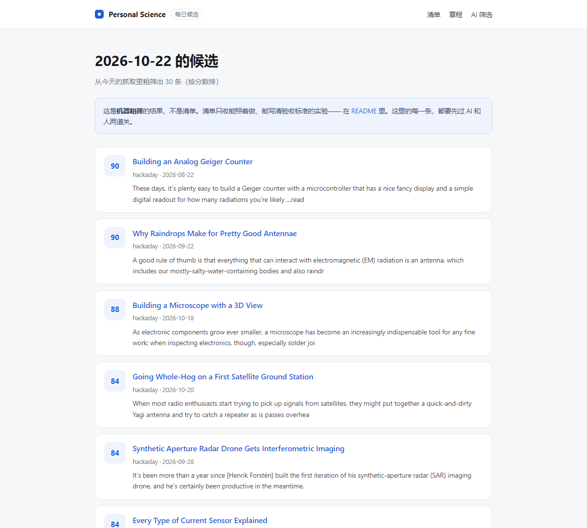

# Personal Science

> 科研平权：让没有实验室、没有学历、没有经费的人，也能亲手做出真实验。

一个人在家就能做的实验清单。不用申请、不用审核、不用等人批准。
**一个人 = 一个实验室。**（[章程](CHARTER.md)）

`12 个实验` · `每页写死验收标准` · `CC0 随便抄` · `每天自动收集候选`

[](https://github.com/dongsheng123132/personal-science/actions/workflows/collect.yml)

[一分钟版本](#一分钟版本) · [清单](#清单) · [每天在长出来](#每天在长出来) · [怎么加一个](#怎么加一个) · [章程](CHARTER.md)

---

## 一分钟版本

1. **挑一个** —— 下面按领域分好了，30 分钟到 5 天的都有
2. **照着做** —— 每页都写了：要什么、怎么做、坑在哪、怎么算做成了
3. **贴结果** —— 做完去 [RESULTS.md](RESULTS.md) 加一行，**失败的也收**

没有评分，没有认证，没有"科班 / 民间"之分——只看做出来的东西。

---

## 这个仓库是什么，不是什么

| 是 | 不是 |
|---|---|
| 一份能照着动手的清单 | 科普文章合集 |
| 一个人的测量记录 | 期刊论文 |
| 成功和失败都收 | 只收漂亮结果 |
| 谁都能提 PR | 要审核的社区 |
| 免费、可抄、CC0 | 课程 / 证书 / 付费社群 |

**适合**：有一张桌子、有点好奇心、想动手但不知道从哪开始的人。
**不适合**：想要现成结论的、想攒证书的、想找"权威背书"的。

---

## 为什么叫 Personal Science

个人电脑把计算权力给了个人。**personal agent 把"一个团队才能干的活"给了一个人。**

下一格是同一件事：

| | |
|---|---|
| personal agent | 一个人 = 一个团队 |
| **personal science** | **一个人 = 一个实验室** |

普通人进不了科研，门槛从来不是智商，是四样东西：

**设备、术语、方法、没人告诉你下一步该干什么。**

AI 正好一次拆掉这四样。所以不用等谁批准——测量、记录、分析、写报告，一个人就能跑完。
当这些都能被接住，**个人就是最小的科研单位**。科研会像一人公司那样，发生在一张桌子上。

---

## 从哪开始

| 你手上有什么 | 建议先玩 | 大概多久 |
|---|---|---|
| 一台微波炉 + 一板巧克力 | [微波炉测光速](experiments/microwave-speed-of-light.md)——厨房里量出 3×10⁸ | 30 分钟 |
| 一分钱不想花 | [盲测可乐](experiments/blind-cola.md)——先搞清楚自己是不是真喝得出来 | 1 小时 |
| 想买个小玩具 | [两块钱测电池内阻](experiments/battery-internal-resistance.md)——一个电阻就够 | 20 分钟 |
| 想找个理由和网友合作 | [影子测地球半径](experiments/eratosthenes.md)——2200 年前的方法，两个人一天 | 2 天 |

---

## 清单

**怎么读这张表**：`时间` 是一个人做完的时间；`花费` 是"要新买的东西"的价格；`难度` 是动手难度，不是知识难度。

### 物理与测量

| 实验 | 一句话 | 需要 | 时间 | 花费 | 难度 |
|---|---|---|---|---|---|
| [手机慢动作测 g](experiments/falling-g.md) | 用 240fps 视频和一把尺子量出 9.8 | 手机、米尺 | 30 分钟 | ¥0 | ★☆☆ |
| [拍手测声速](experiments/sound-speed.md) | 一声拍手一次回声，算出声速 | 手机、长墙 | 20 分钟 | ¥0 | ★☆☆ |
| [温度计 + 秒表量热平衡](experiments/fridge-thermal.md) | 热水在冰箱里凉得有多慢，指数曲线自己会说话 | 温度记录仪、冰箱 | 2 小时 | ¥20 | ★☆☆ |
| [影子测地球半径](experiments/eratosthenes.md) | 和另一个纬度的人同一天量影子 | 杆子、尺子、一个网友 | 2 天 | ¥0 | ★★☆ |

### 电子与硬件

| 实验 | 一句话 | 需要 | 时间 | 花费 | 难度 |
|---|---|---|---|---|---|
| [两块钱测电池内阻](experiments/battery-internal-resistance.md) | 一块万用表加一个电阻，量出电池的"内耗" | 万用表、10Ω 电阻 | 20 分钟 | ¥10 | ★☆☆ |
| [LED 估普朗克常数](experiments/led-planck.md) | 不同颜色 LED 的点亮电压里，藏着一个量子常数 | 万用表、电位器、5 种 LED | 1 小时 | ¥30 | ★★★ |

### 光与波

| 实验 | 一句话 | 需要 | 时间 | 花费 | 难度 |
|---|---|---|---|---|---|
| [微波炉测光速](experiments/microwave-speed-of-light.md) | 用巧克力把光速量出来 | 微波炉、巧克力、尺子 | 30 分钟 | ¥10 | ★☆☆ |
| [偏振：一块胶带 + 两块屏幕](experiments/polarization-tape.md) | 看见塑料里的应力 | 手机、透明胶带、偏振片 | 20 分钟 | ¥0–20 | ★☆☆ |

### 生物与植物

| 实验 | 一句话 | 需要 | 时间 | 花费 | 难度 |
|---|---|---|---|---|---|
| [种子发芽率对照](experiments/seed-germination.md) | 光照到底影不影响发芽——两种种子给出两个相反的答案 | 种子、纸巾、两个盘子 | 5 天 | ¥10 | ★☆☆ |
| [植物向光性延时](experiments/plant-phototropism.md) | 鞋盒开个洞，看植物怎么"找"到光 | 小植物、鞋盒、手机 | 3–5 天 | ¥10 | ★☆☆ |

### 环境与水

| 实验 | 一句话 | 需要 | 时间 | 花费 | 难度 |
|---|---|---|---|---|---|
| [自来水 TDS 对照](experiments/tds-water.md) | 20 块钱的笔，量出你家水的导电性 | TDS 笔、几个杯子 | 20 分钟 | ¥20 | ★☆☆ |

### 方法与思维

| 实验 | 一句话 | 需要 | 时间 | 花费 | 难度 |
|---|---|---|---|---|---|
| [盲测可乐](experiments/blind-cola.md) | 一套正经的盲测，检验"你真喝得出来吗" | 可乐百事、杯子、一个帮手 | 1 小时 | ¥15 | ★☆☆ |

---

## 点子池

还没人写过方案的点子。想玩哪个，就照着 [实验模板](experiments/_template.md) 写一页——全部清单在 [ideas.md](ideas.md)。

- 用一根 USB 线量出快充为什么变慢
- 手机闪光灯频闪测风扇转速
- CD 片当光栅，测激光笔波长
- Wi-Fi 信号穿墙衰减热图
- 鸡蛋浮沉测盐水密度
- 羽毛球弹性随温度变化
- 煮蛋时间与蛋黄凝固状态
- 超市价格尾数的规律
- 耳机左右声道的一致性

---

## 每天在长出来

这个仓库有一条输送带，**每天在美国的机器上跑一次**（GitHub Actions，免费，不用租服务器）：

```
Hackaday 等源 → inbox/raw.json（宽网，约 90 条/天） → AI 筛 → inbox/candidates.md → 人挑一页 → 进上面的清单
```

脚本负责**看得多**，AI 负责**看得准**，人负责**做得完**。清单进什么，永远由人决定。

| 想知道 | 看这里 |
|---|---|
| 今天抓到什么 | [inbox/raw.json](inbox/raw.json) |
| 机器怎么排的 | [inbox/prefilter.md](inbox/prefilter.md) |
| AI 筛完剩什么 | [inbox/candidates.md](inbox/candidates.md) |
| 网页看板 | [feed/index.html](feed/index.html) |
| 怎么加源、怎么跑 | [collector/README.md](collector/README.md) |
| 放哪跑、放哪看 | [deploy/README.md](deploy/README.md) |



---

## 让 AI 帮你挑

拍一张你的工作台 / 书桌 / 阳台照片，丢给任何会看图的 AI，附上 [SKILL.md](SKILL.md)。

它会从这个清单里挑出**你现在就能玩的**三个，告诉你还差哪件东西、大概多少钱。

它不评价你、不给你打分——只做一件事：把"我这些东西能玩什么"翻译成一句人话。

---

## 怎么加一个

三条要求，详见 [CONTRIBUTING.md](CONTRIBUTING.md)：

1. **个人在家能做完**：预算 ≤ ¥200，时间 ≤ 一个周末，不需要资质和危险操作
2. **写清楚怎么算做成了**：验收标准要能在动手之前写死
3. **写清楚坑和危险**：包括"这条别做"

宁缺毋滥。**一个真能玩的实验，胜过二十条链接。**

---

## 做完往哪贴

去 [RESULTS.md](RESULTS.md) 加一行：用了哪个实验、算出什么数、你觉得差在哪。

**失败的结果更值得写。** 一个"没做成，因为 X"的条目，比十个"成功了"有用。

---

## 我们不做这五件事

- **不认证**：不发证书、不打分、不评"科不科学"
- **不审核身份**：谁都能提 PR，不问你是谁、什么学历
- **不替你做**：AI 可以带你，但不能代替你动手——那就变成看视频了
- **不追热点、不造神**：这里没有大神，只有"做完了的人"
- **不碰危险与资质**：高压、明火、化学品入口、活体实验、需要许可证的检测

这五条写在[章程](CHARTER.md)第五条里。以后谁想加"评分 / 认证 / 门槛"，拿这一条顶回去。

---

## 安全底线

高压电、明火、化学品入口或吸入、活体动物实验、需要资质的检测，这个清单一条都不收。

看到心动但感觉危险的，别做，先开个 issue 问问。

---

## 仓库结构

```
.
├── README.md            你在这
├── CHARTER.md           章程：这个仓库的宪法
├── experiments/         每个实验一页（12 个）
├── ideas.md             点子池
├── RESULTS.md           有人做过什么（含失败）
├── CONTRIBUTING.md      怎么加一个
├── SKILL.md             拍照 → AI 帮你挑现在能玩的
├── collector/           每天采集的脚本
├── inbox/               采集结果 + AI 筛选
├── feed/                网页看板
├── deploy/              放哪跑、放哪看
└── archive/             走错的路（保留，提醒自己别再建平台）
```

---

内容 [CC0](https://creativecommons.org/publicdomain/zero/1.0/deed.zh) · 随便抄，不用署名
